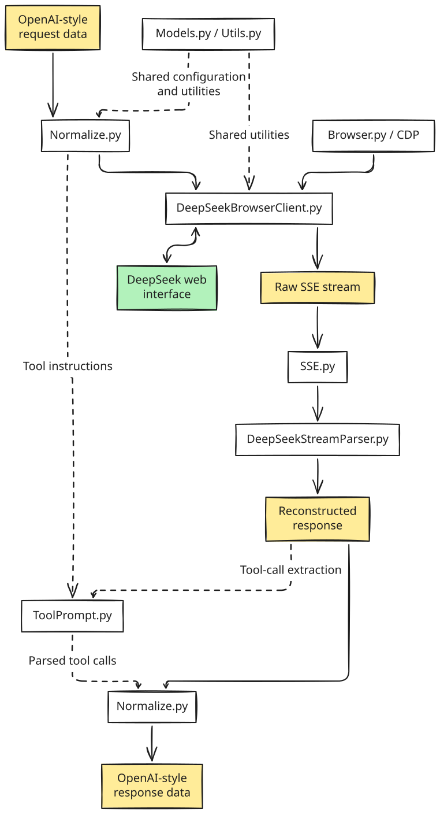

<div align="center">

# FreeAPI

### From browser conversations to programmable interfaces.

**A browser-backed integration layer for LLMs, with OpenAI-style request and response normalization.**

`Browser automation` · `Streaming SSE` · `Tool calling` · `Session management`

[Overview](#overview) · [Getting started](#getting-started) · [Architecture](#architecture) · [Capabilities](#capabilities) · [License](#license)

Version: **Gamma 0.1.2**(Developing)

</div>

---

**LLM APIs cost a fortune?**  
**Your Plus subscription limits keep getting in the way?**

**What if I told you...** you could turn free AI chat websites into programmable workflows?

**Sounds interesting?** Meet **FreeAPI** Now!

## Overview

FreeAPI bridges the gap between the website chat and your favorite AI-powered applications. Instead of being limited to chatting in a browser, you can bring it into your own projects, tools, and workflows through a familiar API-style interface.

No complicated setup concepts. No need to understand what's happening behind the scenes. Just a simpler way to connect the tools you love with the AI you love. Everything is just like you are using an official API, of course, without any possible costs or limits.

So what can you do with FreeAPI?

- Connect your favorite tools: Bring web-based AI into applications and workflows that support compatible API interfaces.
- Keep the conversation flowing: Work with regular responses or real-time streaming.
- Go beyond simple chat: Explore tool calling and more advanced AI-powered workflows.
- Made for curious minds: Whether you're a developer, researcher, student, or simply an AI enthusiast, FreeAPI is designed to make experimentation more accessible.

All in all, you bring the ideas, and FreeAPI helps make the connection.

## Getting started

Ready to give FreeAPI a try? Let's get you up and running!

### Requirements

Before we begin, make sure you have:
- **Python 3.12 or newer** — [Download Python](https://www.python.org/downloads/)
- **Git** — [Download Git](https://git-scm.com/downloads)
- **Google Chrome** — For browser-based AI interactions

### Installation

First, clone the repository:

```bash
git clone https://github.com/SKlight-Liang/FreeAPI.git
cd FreeAPI
```

Next, install FreeAPI and its dependencies:

```bash
pip install -e .
```

That's it! Python will take care of installing the required packages.

> [!TIP]
> We highly recommend using **a virtual environment** to avoid conflicts with other Python packages. What? You ask me how to create a virtual environment? Maybe you can turn to little blue whale for help. 

### Run

Now for the fun part! Start FreeAPI with:

```bash
FreeAPI-Chat -i -d -p PORT
```

FreeAPI will launch its command-line entry point.

> [!NOTE]
> The `-i` flag enables interactive mode, allowing you to chat with the AI in multiple rounds. The `-d` flag means that the chat session will be deleted after completion. The `-p PORT` flag specifies the port number for the browser's CDP debugger (default is 9222). If you meet any issues, you can try changing the port number to avoid conflicts.

### What's Next?

Once FreeAPI is running, you're ready to explore how to connect web-based AI services to your own applications and workflows.

## Architecture

If you are curious about how FreeAPI works under the hood, here's a brief overview of its architecture. Of course, we are still working on this project, so this section just provides a high-level view of the current design.

The architecture is designed to be modular and extensible, allowing for easy integration of new features and services.

<p align="center">
  
</p>

In this diagram, you can see how requests are parsed and sent to the browser for processing, and how response streams will be intercepted and transformed into an OpenAI-style format. This is friendly for your applications or workflows to consume. YUMMY!

<details>
<summary><strong>Follow a request through the system</strong></summary>

1. **Normalize input.** `NormalizeCompletions` or `NormalizeResponses` converts supported OpenAI-style payloads into an internal representation.
2. **Prepare the browser.** `Browser.py` locates and launches a Chromium-based browser with CDP enabled; the client attaches through Playwright.
3. **Interact with DeepSeek Chat.** `DeepSeekBrowserClient` manages page access, session switching, file uploads, and chat submissions while observing network responses.
4. **Decode streaming updates.** `SSEParser` frames events, while `DeepSeekStateDecoder` applies incremental updates to reconstruct the message state.
5. **Recover structured output.** `Normalize.py` transforms the resulting text and parsed tool calls into OpenAI-style message or response objects.

</details>

## Capabilities

| Area | Implementation | What it provides |
| :-- | :-- | :-- |
| Browser integration | `Browser.py`, `DeepSeekBrowserClient.py` | CDP-based browser launch and Playwright-backed interaction with DeepSeek Chat. |
| Conversation lifecycle | `DeepSeekBrowserClient.py` | Session switching, session deletion, and serialized browser operations. |
| Streaming | `SSE.py`, `DeepSeekStreamParser.py` | Incremental SSE parsing, state updates, text deltas, and response metadata. |
| Request / response translation | `Normalize.py` | Conversion for OpenAI-style Chat Completions and Responses data structures. |
| Tool calls | `ToolPrompt.py` | Tool instructions and parsing of complete or streamed tool-call markup. |
| Attachments | `DeepSeekBrowserClient.py`, `Normalize.py`, `Utils.py` | File upload handling, content decoding, and MIME detection. |
| Model configuration | `Models.py` | Configuration for `deepseek` and `deepseek(faster)` modes. |
| CLI workflow | `ChatBrowser.py` | A browser-backed chat entry point, including optional interactive conversation. |

## License

FreeAPI is an open-source software released under the [MIT License](./LICENSE). You're welcome to use, modify, and share it! Of course, nothing could be better if you could give us a star on GitHub and advertise it to your friends!

> [!IMPORTANT]
> We built FreeAPI to make AI more accessible, not to encourage abuse of free services. Please use this project responsibly, include but not limited to:
> - **Respect the platforms.** Follow the terms of service and usage policies of the AI providers you interact with.
> - **Be mindful of shared resources.** Avoid excessive automated requests or activities that could disrupt services for others.
> - **Play fair.** Don't use FreeAPI to bypass security measures, evade restrictions, or engage in malicious activities.
>
> **Let's keep AI accessible, sustainable, and enjoyable for everyone!**

>[!WARNING]
> We are not affilicated with any AI providers, and FreeAPI is not an official client. So we still insist on using official APIs for production or commercial purposes. FreeAPI is intended for personal use, experimentation, and learning. Please be aware of the risks and limitations when using it with third-party services. 
> 
> **Our team are not responsible for any consequences arising from its use, including account suspension, service disruption, or legal issues.**

---

<div align="center">

**FreeAPI** · Browser-native integration, interface-oriented design.

<sub>Independent project. Not an official client.</sub>

</div>